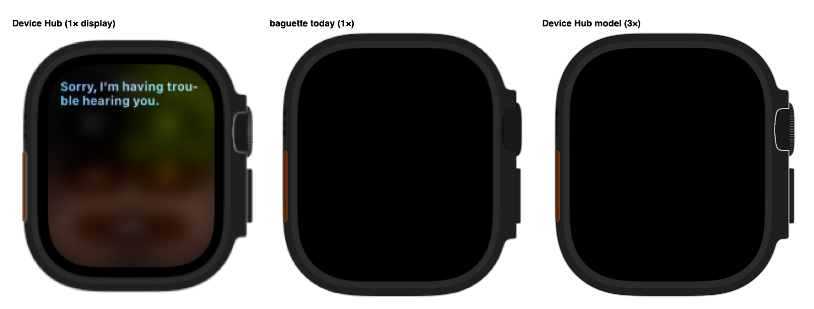
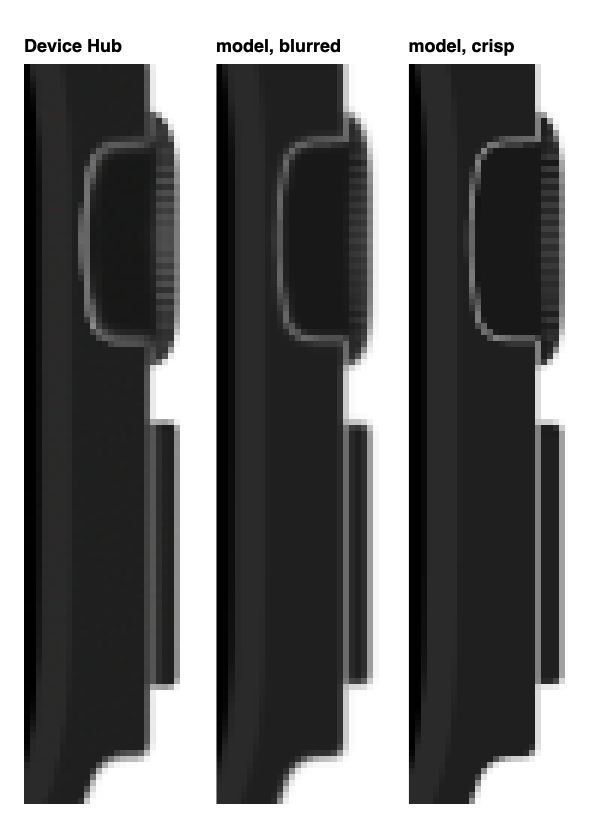

# Matching Device Hub's bezel

> **Status: RESEARCH + DESIGN, 2026-10-20. Nothing here is built.** Baguette
> still rasterizes chrome at 1×, draws behind-the-case buttons under the whole
> case, and draws no crown ridges. Measured against Device Hub from Xcode 27.1
> beta (`DeviceHub.app`, `DeviceKit.framework`) on Apple Watch Ultra (49mm),
> chrome `watch4`, on a 1× display.

| For | Read |
|---|---|
| chrome.json offsets, the `2N − R` rest rule, `devicePadding` | [design.md](design.md) |
| Routes and the flat / actionable views | [README.md](README.md) |
| How the page draws the bezel | [baguette-sdk](../baguette-sdk/README.md) |

## The one sentence

Device Hub draws **the same parts** baguette reads, but follows three
rendering rules baguette doesn't: it draws them as vectors at screen scale; it
shows a behind-the-case button only where the case is fully transparent; and it
paints ridges over the Digital Crown.



## Ubiquitous language

| Term | Meaning | Not to be confused with |
|---|---|---|
| **Case** | The device body: the chrome's composite PDF (`WatchComposite.pdf`) | The bezel PNG, which also carries buttons |
| **Crown-guard notch** | The cut-out in the case's right rail where the crown shows; on `watch4` roughly x 276–296, y 89–140 pt | The crown itself — Device Hub's outlined "face" is this notch |
| **Case edge** | The 1 pt rim around the case's silhouette and its notch: black at 20 % opacity | A light outline. It only *looks* light where background shows through it |
| **Behind-the-case button** | An input with `onTop: false` (crown, side button, every iPhone rail button) | `onTop: true` caps such as the Action button, drawn over the case |
| **Ridges** | The knurling DeviceKit paints over the crown's right quarter (`drawCrownLines`) | Anything in `DigitalCrown.pdf` — the art has none |
| **Render scale** | Pixels per chrome point used to rasterize | Layout, which stays in chrome points |

## What Device Hub does

1. **Same bundle.** Device Hub has `/Library/Developer/DeviceKit/Chrome` open
   (`lsof`), and `DeviceKit` parses the same `chrome.json` keys. Neither app's
   `Assets.car` contains bezel art, and there's no second `.devicechrome`
   anywhere.
2. **Vector at screen scale.** `DigitalCrown.pdf` has a fine rim and edge
   shading that vanish at 1×. Baguette's 1× PNG, scaled up by the page, loses
   them.
3. **Crown behind the case, seen through the notch.** The outlined "face" of
   Device Hub's crown has exactly the notch's shape. The crown sits at its
   chrome.json rectangle (x 273, y 81, 25×67), behind the case, as
   `onTop: false` says.
4. **Buttons held back from the case edge.** Device Hub draws little or
   nothing behind the case edge's semi-transparent band, so the window
   background shows through it as a light grey line around the notch, and
   along the side button's case edge. Fitting "how much of the button shows
   under the band" (`chrome-lab fit`): fully, as baguette does today, is the
   worst fit at every blur (RMSE 15.6–18.2); 0–25 % fits best (9.5–11.0), and
   the 1× capture can't separate those. With none showing, total light in the
   line matches Device Hub's to within ~8 % (left edge 126 vs 135; bottom ≈108
   vs ≈100 per column).
5. **Ridges, decoded from `DeviceKit`** (`drawCrownLines(context:size:displayScale:)`,
   ~`0x52dd7c`; its loop at `0x52f634`). For a crown of view size w × h whose
   art is `artW` wide:
   - spacing `s = 3 × w / artW`; start `y = h/2 + remainder(scrollOffset, s)`,
     then walk up and down while `1 < y < h − 1`;
   - `c = max(0, 1 − |y − h/2| / (h/2))` — 1 at the centre, 0 at the ends;
   - stroke from `x = 0.875w − len/2` to `+ len`, where
     `len = 0.2125w × (0.4 + 0.6 × clamp(1 − u², 0, 1))`, `u = 2y/h − 1`;
   - colour `Color.white.opacity(0.4 × (0.8c + 0.2))`, style
     `StrokeStyle(lineWidth: w/artW, lineCap: .round, lineJoin: .miter, miterLimit: 10)`;
   - next step `s × clamp(ln(max(c, 1e-6)) × 0.298671653 + 1.097005268, 0.2, 1)`;
   - all inside `drawLayer`, clipped to the right quarter `(0.75w, 0, 0.25w, h)`,
     then `blendMode = .destinationIn` with the crown art drawn over it, so the
     strokes keep only the crown's shape.
6. **Rest positions differ slightly** (measured, ±0.75 pt at Device Hub's
   0.66× scale). Side button: x ≈ −33.5, where baguette's `2N − R` gives −35
   and `normal` is −30. Crown: ≈ 0.5 pt further out than chrome.json.
7. **Device Hub is soft on a 1× display.** It scales a low-resolution bitmap,
   which blurs by ~0.5–0.7 px; that's why its outline reads mid-grey. Don't
   copy the blur — render crisp and let the display decide.



## What is wrong today

| Gap | Where baguette does it |
|---|---|
| Rasterized at 1×, upscaled by the page | `CoreGraphicsPDFRasterizer.rasterize` / `compose` / `compose9Slice` |
| Behind buttons drawn under the whole case, so the edge band darkens them | `LiveChromes.assemble` (`behindLayers`); `parts/button.js` stacks the cap image at `z-index: 0` under the bezel `` |
| No ridges on the crown | Not drawn anywhere |
| A crown can't be told from a button | `ChromeButton` doesn't parse `inputs[].type` |

## The aggregate, from the root down

```
DeviceChrome                         chrome.json, in chrome points — the only geometry
├─ case (composite / 9-slice)        its fully transparent pixels are where behind buttons may show
└─ buttons: [ChromeButton]           anchor · offsets · onTop · kind (button | crown)   ← kind: new
   └─ crown → CrownRidges            the strokes DeviceKit paints, in crown space       ← new
DeviceChromeAssets                   images at render scale; every size still in points
```

## The tells

```swift
// The crown answers for its own ridges; nobody reaches into its offsets.
if case .crown = button.kind {
    let strokes = CrownRidges(crownSize: rect.size, artWidth: art.size.width, scrollOffset: 0).strokes
}
// Compose is told which layers sit behind the case; it alone decides where they may show.
rasterizer.compose(canvasSize: size, behind: behindLayers, case: caseLayer, onTop: onTopLayers)
```

## Invariants — each law, one owner

| Law | Owner |
|---|---|
| Layout is in chrome points; pixels never reach a coordinate | `ChromeImage` (pixel scale carried beside `size`) |
| A behind-the-case button shows only where the case is fully transparent | `PDFRasterizer.compose` for every PNG. **Second owner by necessity:** the page's overlay (`button.js`) must obey the same rule; it should consume one served case mask, never re-derive it |
| Ridge geometry, colour and spacing are DeviceKit's constants above | `CrownRidges` |
| Where a cap rests | `buttonTopLeft` (Swift) and `Button.box` (JS), already two owners; see [design.md](design.md) |

## Build sequence

Test-first, each slice green on its own:

1. **`CrownRidges`** (Domain): `should space crown ridges three art points apart at the crown's centre`, `should fade crown ridges toward the crown's ends`, `should keep crown ridges inside the crown's right quarter`.
2. **`ChromeButton.kind`**: `should read a crown from a chrome input of type crown`.
3. **Render scale**: `should rasterize a chrome PDF at three pixels per chrome point`, while the size stays in points.
4. **Hold-back**: `should show a behind-the-case button only where the case is fully transparent`.
5. **Crown sprite**: bake the ridges into the merged bezel and `/chrome-button/digital-crown.png`.
6. **Page**: mask the actionable overlay with the case's transparent area; `captureSourceSize` (`sim-stream.js`) reads the bezel's pixel width and must switch to layout size.
7. **Rest positions**: only after a crisp reference settles open question 3.

## How it was measured

[`scripts/chrome-lab.swift`](scripts/chrome-lab.swift) holds the model above
(`render`), the fit against a capture (`fit`), the Device Hub capture
(`capture`) and the side-by-side images (`compare`).
[`scripts/make-assets.sh`](scripts/make-assets.sh) rebuilds it and regenerates
`assets/` from the committed capture,
[`assets/device-hub-watch4-1x.png`](assets/device-hub-watch4-1x.png) (Physical
Size, 1× display, cropped to the watch).

- **Same bundle:** `lsof -p <DeviceHub pid>`; `strings -a DeviceKit | grep chrome.json`.
- **Decoding:** `otool -tV DeviceKit` → find `add …; literal pool for: "drawCrownLines…"`, walk back to `pacibsp`. Float constants come from `fmov` immediates and `ldr d, [adrp …]` (read the 8 bytes at that address: `TEXT` is mapped at file offset 0). SwiftUI calls resolve via `otool -v -s __TEXT __auth_stubs` → GOT slot → `xcrun dyld_info -fixups` → `swift-demangle`.
- **Captures** (`chrome-lab capture`): `screencapture -o -l <window id>` of the Device Hub window; zoom through its "Zoom In" / "Physical Size" toolbar buttons via the Accessibility API.
- **Fits** (`chrome-lab fit`): render case, buttons and ridges at 8× Device Hub's 0.6624 px/pt, box-average onto the capture's pixels, and take the least squares over the crown, notch and side button while sweeping alignment, blur and how much of a button shows under the case edge. The side-button and crown offsets (`--device-hub-rest`) came from the same fit with those as parameters.

## Open questions

1. Exact ridge width and brightness: Device Hub's look brighter and a touch wider than the decoded spec renders, but 3 pt pitch is ~2 px at 0.66×, so the fit is noise-bound. **Needs a 2× capture** (Device Hub on a Retina display).
2. The faint inner highlight on Device Hub's side button: not in `SideButton.pdf`, source not found.
3. The rest-position rule: −33.5 for the side button is neither `2N − R` (−35) nor `normal` (−30). Confirm on a 2× capture before changing `buttonTopLeft`.
4. Does the hold-back rule look right on iPhone rails (`phone11`) and the iPad top button? Compare against Device Hub before shipping slice 4.
5. Device Hub turns the ridges with crown scrolls (`scrollOffset`). Animate in the page, or keep them static?
6. Hard or partial hold-back? A button fully hidden under the case edge and one 25 % visible fit about equally at 1×. Hard (none) is the simpler rule and matches the line's measured brightness; confirm on a 2× capture before slice 4.
7. ~~Does Device Hub load other assets?~~ No: one bundle (`lsof`), no art in either `Assets.car`.
8. ~~Is the outlined face a different crown PDF, mirrored art, or `watch6`?~~ No: it's the case's notch; `watch4` fits best of all bundles.
9. ~~Is the light outline a hover highlight?~~ No: identical with the pointer off the window.
10. ~~Is the outline a different grey?~~ No: same total light; Device Hub's 1× blur spreads it.
